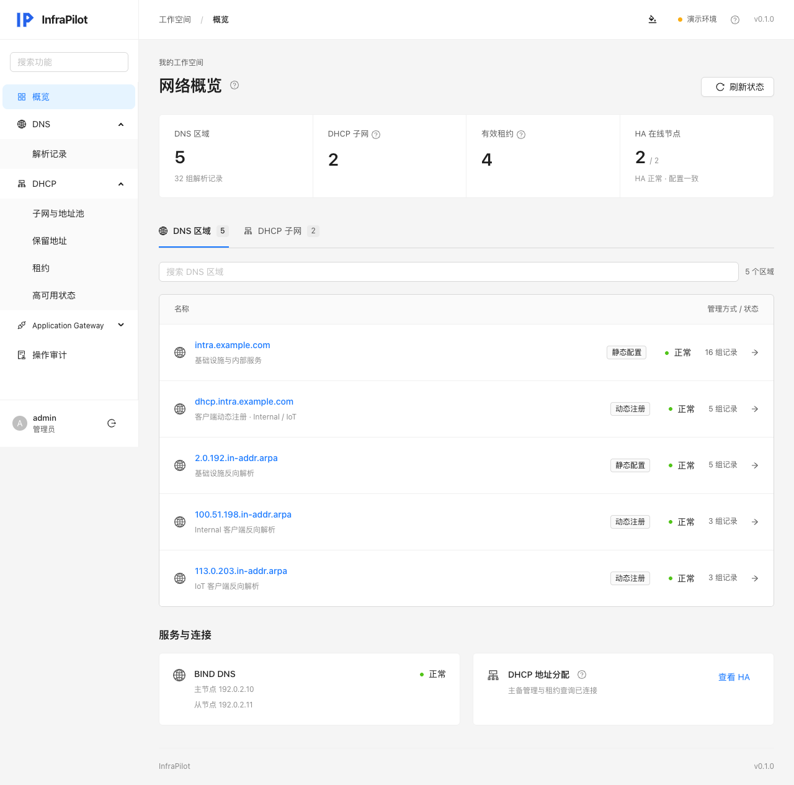
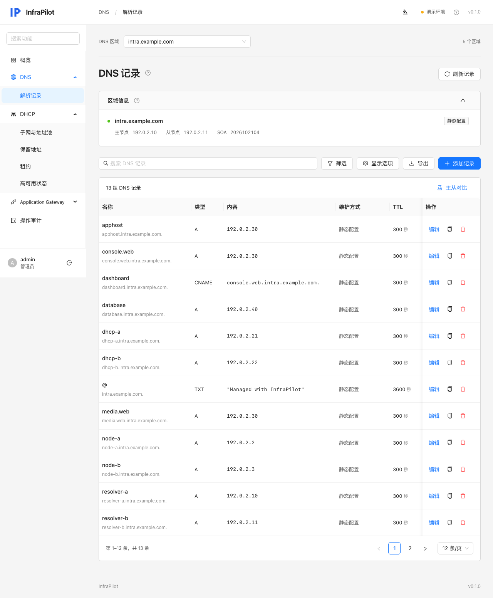

# InfraPilot


基于 **Java 21 / Spring Boot + Vue 3 / Ant Design Vue** 的 DNS、DHCP 与 **Application Gateway** 管理面板，前后端独立构建、独立部署。

通过 AXFR 读取区域，使用 RFC2136 + TSIG 原子更新记录集。BIND 继续负责主从同步和 DNSSEC 签名；Kea 继续管理客户端 DDNS。





## 已实现

- Session 登录、CSRF 防护，管理员和只读用户；账号凭据通过环境变量配置。
- 区域概览、记录搜索、类型筛选、系统记录显示开关。
- 原生浅色、[深色模式](docs/screenshots/dark.png)及跟随系统，浏览器记住选择；解释性文案收纳为支持悬停、键盘和触屏的问号提示。
- A / AAAA / CNAME / MX / TXT / PTR / SRV / CAA，以及 TLSA / SSHFP / NAPTR / URI / SVCB / HTTPS 等 25 种常规记录类型增删改、TTL、多值编辑及提交前预览。
- 修改前校验记录版本，DNS UPDATE 携带旧记录集前置条件，未签名区域额外校验 SOA；检测到并发冲突返回 409。
- Kea 区域只读，DHCID 名称、DNS 系统记录及已委派子域保护。生产中需同时配置 BIND 侧权限。
- 主从实际 DNS 查询对比：回答、SOA 序列号、响应耗时和错误信息。
- [条件转发](docs/CONDITIONAL-FORWARDING.md)：接入现有 DoT 规则，管理 DNS / DoT 上游、TLS 校验域名和转发模式；双节点预校验、重载回读、持久化事务和备份恢复。
- [BIND 管理](docs/BIND-MANAGEMENT.md)：主从区域创建与初始数据导入、全局递归与缓存、ACL / Views、DNSSEC / TSIG、DoT / DoH、日志统计、预设运维命令及完整原生配置编辑；两节点预校验、差异预览、持久事务与私密备份恢复。
- Kea DHCPv4 子网、地址池和 MAC 保留地址管理，租约查询/释放、重发 DDNS，以及双节点 HA 状态。
- 配置变更先在两台 Kea 预校验，保存时保留各自 HA/DDNS 配置，并记录审计；部分失败时尝试回滚。
- [Application Gateway](docs/APPLICATION-GATEWAY.md)：接入 APISIX Admin API，管理路由、服务、上游、消费者/凭据/分组、证书、全局规则、插件配置/元数据、TCP/UDP 路由、Protobuf 和 Secret；查看实时插件与 Schema、只读节点配置。
- 网关支持基础表单与完整 JSON、提交前校验和差异预览、敏感字段原值保留、版本检查、私密回滚备份、回读确认和配置导出；每次恢复也会备份当前状态。
- 持久化变更审计，包括修改前后内容、操作人、时间、PENDING / SUCCESS / FAILED 状态。
- Docker Compose、接入模板、后端测试、浏览器端到端测试和 GitHub Actions。
- 独立演示模式：DNS/DHCP/网关示例数据保存在后端内存中，重启重置；审计日志与网关变更备份单独持久化。

BIND 高级选项通过当前版本的原生配置语法维护；插件、HSM、证书等外部依赖需预先提供。主从角色调整还需协调外部 DDNS 与签名密钥。A 与 PTR 是不同区域的独立操作，不提供跨区域事务或自动 PTR 联动。DHCP 目前支持 IPv4，不自动配置路由器、VLAN 或 relay。

## 本地启动

需要 Java 21+、Maven 3.9+、Node.js 22.12+。不需要本机 BIND。

```sh
# 终端一
cd backend
mvn spring-boot:run

# 终端二
cd frontend
npm ci
npm run dev
```

打开 http://127.0.0.1:5173 。开发服务器将 `/api` 代理到后端 8080，前端不存储密码或访问令牌。

默认是演示模式。点击「填入演示账户」后登录，或使用 `admin / infrapilot-demo`。该默认密码仅在演示模式可用；生产模式要求显式提供不少于 16 字符的管理员密码。

## Docker Compose

```sh
# 例如部署到 /opt/ryanbuu/infrapilot
git clone git@github.com:ryanbuu/infrapilot.git /opt/ryanbuu/infrapilot
cd /opt/ryanbuu/infrapilot
cp .env.example .env
docker compose up -d --build
```

默认访问 http://127.0.0.1:8088 。前端 Nginx 与 Java 后端为两个容器，只有前端发布端口；`audit-data` 卷保存审计数据库。应用容器以非 root 用户运行。

接入实际 BIND：

1. 先按 [BIND 接入说明](docs/BIND-INTEGRATION.md) 创建专用 TSIG 身份、授权 AXFR 和精确的更新权限；保留现有 Kea 身份及主从配置。
2. 复制 `deploy/application-live.example.yml` 到 `deploy/config/application.yml`，检查区域、主从地址、只读策略和密钥名称。
3. 修改 `.env`，设置 `INFRAPILOT_MODE=live`、`INFRAPILOT_TSIG_SECRET` 以及独立的管理员密码；生产配置和 `.env` 均已被 Git 忽略。
4. HTTPS 反代部署时设置 `INFRAPILOT_SESSION_COOKIE_SECURE=true`，由现有 APISIX 将指定域名转发到前端发布端口。按反代所在网络配置 `INFRAPILOT_LISTEN_ADDRESS`，默认只监听本机。
5. `docker compose up -d --build`。先核对区域读取、只读保护、测试记录及从节点同步，再交付日常使用。

仓库没有包含任何现网 API Key、SSH 私钥或 TSIG 密钥。公开示例与截图使用 RFC 5737 文档地址及 example.com 域名；应用不会自动修改 BIND 权限。

## 验证

```sh
mvn -f backend/pom.xml verify
npm --prefix frontend ci
npm --prefix frontend run build
cd frontend
npx playwright install chromium  # CI / Linux；macOS 本地测试默认使用已安装的 Chrome
npm run test:e2e
```

手机导航另有 WebKit 回归检查：在 `frontend` 中执行 `npx playwright install webkit`、`npm run test:e2e:webkit`。浏览器触摸模拟和 WebKit 检查覆盖布局与交互，不代替真机 iOS Safari 验证。

浏览器测试启动隔离的内存数据库后端和开发前端，验证登录、DNS 记录及 DHCP 子网/保留地址的增删改、预览、HA 页面、审计、路由重载与手机导航（实色抽屉、遮罩/关闭、滚动与焦点隔离、横竖屏切换），并覆盖系统主题跟随、手动偏好保留、深色弹窗及问号提示的悬停、键盘与触屏交互。后端测试覆盖实际 TCP DNS 报文、TSIG、AXFR、UPDATE 前置条件，以及 Kea HTTP 认证、权限、配置保留、冲突、租约操作和部分失败回滚。这些测试使用隔离数据，不写生产 DNS/DHCP，也不等同于现网接入验收。

CI 以 Java 21 和 Node.js 22 构建、测试。测试截图使用演示数据。

## 配置和运行

- `INFRAPILOT_MODE`：`demo` 或 `live`；未知模式或缺少生产区域/密钥/管理员密码会拒绝启动。
- `INFRAPILOT_ADMIN_USERNAME` / `INFRAPILOT_ADMIN_PASSWORD`：管理员；修改环境变量后重启后端生效。
- `INFRAPILOT_VIEWER_USERNAME` / `INFRAPILOT_VIEWER_PASSWORD`：可选只读账号，密码为空则不创建。
- `INFRAPILOT_SESSION_COOKIE_SECURE`：HTTPS 下应为 `true`。
- 默认审计数据库为 `jdbc:h2:file:./data/infrapilot`；可通过 `INFRAPILOT_DATABASE_URL`、`INFRAPILOT_DATABASE_USERNAME`、`INFRAPILOT_DATABASE_PASSWORD` 切换 PostgreSQL。首次启动自动创建审计表，部署前应为 PostgreSQL 准备独立数据库和最小权限账号。
- 数据库不可写时不会发送新的 DNS 更新。DNS 已成功但最终审计落盘失败时返回明确错误，原意图保持 PENDING，需查询实际记录核实；DNS 更新与数据库不是分布式事务。
- 网络超时可能意味着更新已到达 BIND，不能确认结果时不要盲目重试，先刷新记录。
- 只读用户可浏览 DNS 和 DHCP 状态，不能修改配置、操作租约或读取审计。
- DNS 服务器地址、端口和密钥仅由后端部署配置决定，不能通过浏览器任意指定。

停止面板不会停止 BIND、Kea 或现有区域同步。

[API 说明](docs/API.md) · [BIND 接入说明](docs/BIND-INTEGRATION.md) · [DHCP 管理说明](docs/DHCP.md) · [命名迁移](docs/MIGRATION.md)

Application Gateway 的完整能力、接入变量、备份和版本限制见 [网关管理说明](docs/APPLICATION-GATEWAY.md)。该模块仅供管理员使用，Admin API 密钥保留在服务端。

前端继续使用 Ant Design Vue 默认组件主题，整体布局参考 Cloudflare 面板：分组侧栏、网络概览、DNS 记录与 DHCP 管理、审计，以及手机端卡片。DNS 支持区域切换、通栏表格、展开编辑、筛选与列显示，当前筛选记录可导出为 zone 文本片段。

DHCP 管理支持子网、地址池、保留地址、租约和 HA 状态，采用双节点预校验、保存和审计。保留地址可独立设置网关、DNS、搜索域、NTP、MTU、网络启动和附加选项，留空继续继承网络设置；宽屏列表展示网关与 DNS，手机使用卡片。连接设置、继承语义与失败恢复限制见 [DHCP 管理说明](docs/DHCP.md)。
